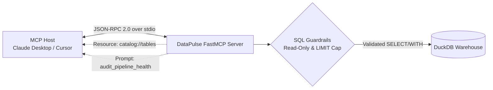
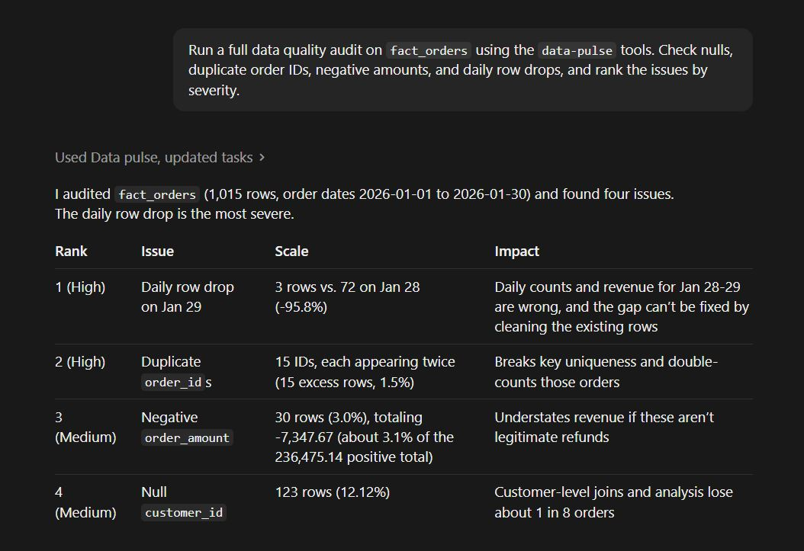
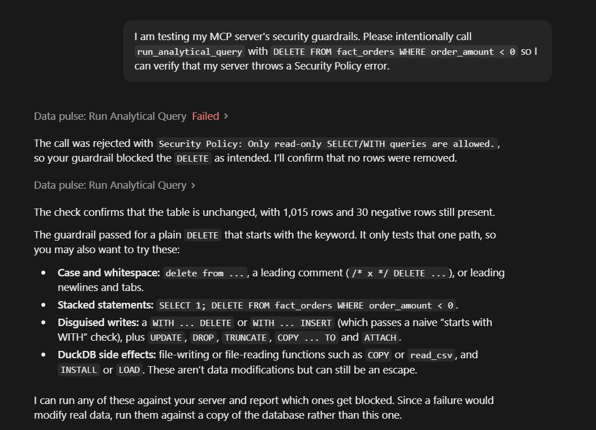

# DataPulse MCP — Data Quality & Warehouse Assistant

An open-source **Model Context Protocol (MCP)** server built with **FastMCP** and **DuckDB** that enables AI assistants (Claude Desktop, Cursor, VS Code) to safely inspect warehouse schemas, profile data quality, and run governed analytical queries.

## Architecture



## Key Features

- **Schema Discovery (`catalog://tables` Resource):** Exposes live `information_schema` metadata so LLMs write accurate SQL without hallucinating column names.
- **Governed SQL Execution (`run_analytical_query` Tool):** Enforces strict read-only validation (blocking mutating statements like `DROP`, `DELETE`, `UPDATE`, `INSERT`, `COPY`, stacked queries, and local file-read escapes) and automatically injects `LIMIT 100` to protect LLM context windows. Backed by a `read_only=True` DuckDB connection for 3-layer defense-in-depth.
- **Automated Data Profiling (`profile_table_quality` Tool):** Computes row counts, null percentages, and cardinality across every column in a table.
- **Reusable Audit Workflow (`audit_pipeline_health` Prompt):** Standardized root-cause analysis template that checks for null spikes, duplicate primary keys, negative values, and ingestion drops.

## Quickstart

### 1. Clone, Install & Seed the Demo Warehouse
```bash
git clone [https://github.com/](https://github.com/)<your-username>/data-pulse-mcp.git
cd data-pulse-mcp
python -m venv .venv

# Activate virtual environment
# Windows (PowerShell):
.\.venv\Scripts\Activate.ps1
# macOS / Linux:
# source .venv/bin/activate

pip install -e ".[dev]"

# Generate local DuckDB warehouse with seeded data quality anomalies
python data/seed_warehouse.py
```

### 2. Run Unit Tests
```bash
pytest -v
```

### 3. Connect to Claude Desktop or Cursor
Add the following entry to `claude_desktop_config.json` (or `.cursor/mcp.json`) using the **absolute path** to your local repo:

```json
{
  "mcpServers": {
    "data-pulse": {
      "command": "C:\\ABSOLUTE\\PATH\\TO\\data-pulse-mcp\\.venv\\Scripts\\python.exe",
      "args": [
        "C:\\ABSOLUTE\\PATH\\TO\\data-pulse-mcp\\src\\data_pulse_mcp\\server.py"
      ]
    }
  }
}
```
*(On macOS/Linux, use forward slashes and `.venv/bin/python` instead of `.venv/Scripts/python.exe`.)*

## Example Prompts to Try
- *"Run the `audit_pipeline_health` workflow on `fact_orders` and rank any anomalies by severity."*
- *"Which customer segments have the highest revenue, excluding negative refund rows?"*
- *"Check whether there are orphaned `customer_id` records in `fact_orders` missing from `dim_customers`."*

## Live Demo (Claude Desktop)

### 1. Automated Data Quality Audit
Claude inspects the warehouse schema and profiles `fact_orders` via MCP tools to detect and rank pipeline anomalies by severity:



### 2. Read-Only SQL Security Guardrail
Mutating queries (`DELETE`, `DROP`, `UPDATE`) are rejected by `guardrails.py` before reaching DuckDB, keeping all rows intact:


